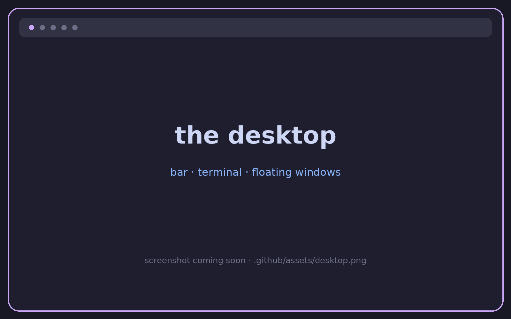
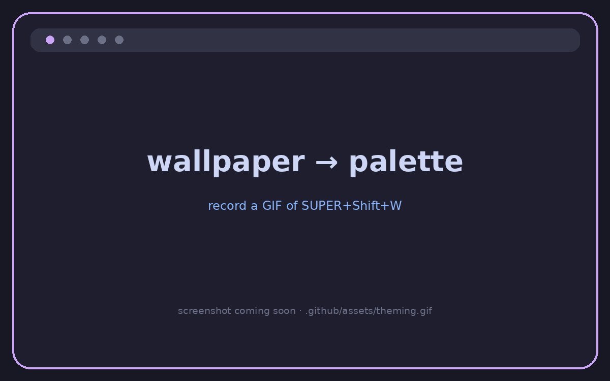
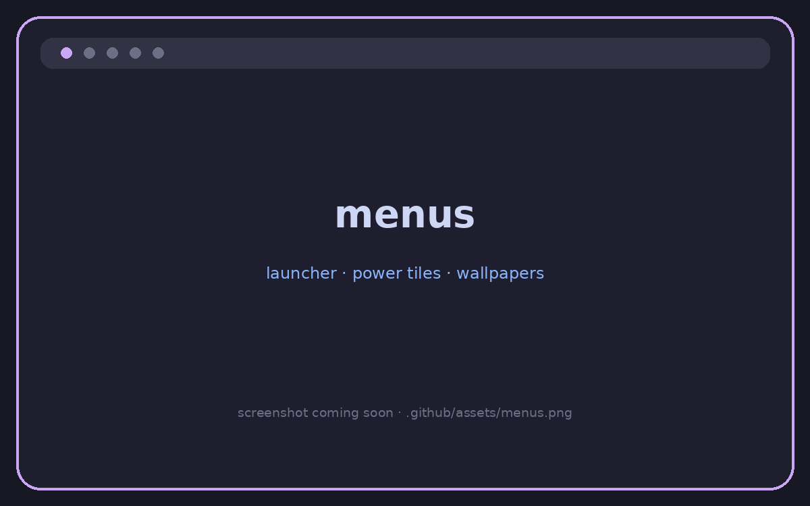
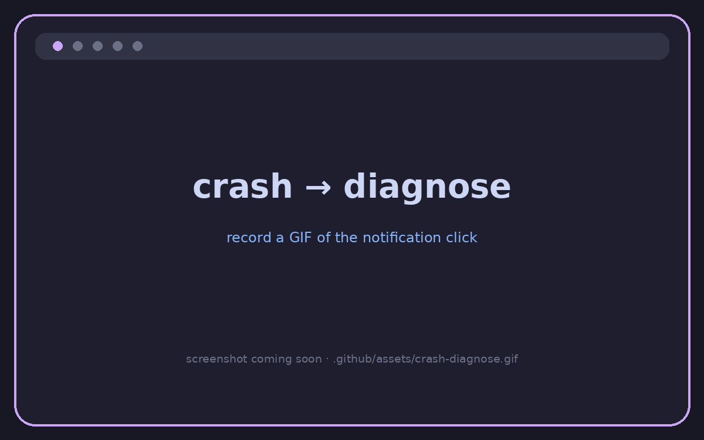
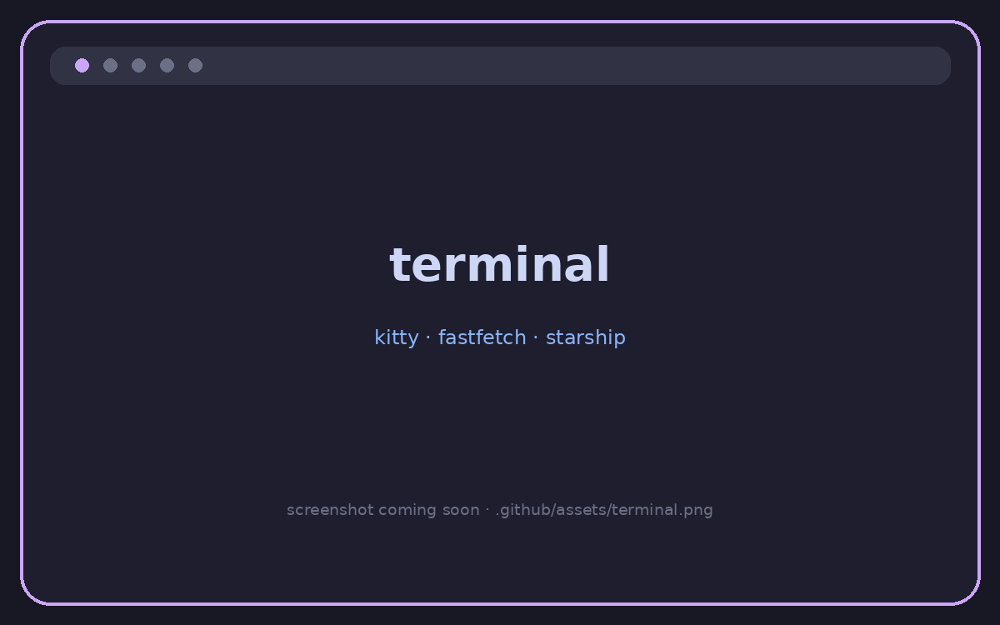

  
  
  
  

  
  
  
  

 

> **My daily driver**, built by hand on a bare Arch install. I started from HyDE's look,
> threw away everything I didn't understand, and rebuilt the rest one layer at a time.
> No installer, no theme engine, no background daemons: ~20 short scripts and a palette
> that follows the wallpaper.

## Gallery

<table>
  <tr>
    <td width="50%">
<b>Lock = login.</b> tty1 autologin hands off to hyprlock. Clock set in <i>KhatibScript</i>, my own font.
</td>
    <td width="50%">
<b>Wallpaper in, palette out.</b> One pick recolours the bar, menus, terminal, borders, lock screen and GTK.
</td>
  </tr>
  <tr>
    <td width="50%">
<b>One menu system.</b> Launcher, wallpapers, emoji, clipboard, keybind cheat sheet, power tiles.
</td>
    <td width="50%">
<b>Crash → click → diagnosis.</b> An AI agent reads a facts report in read-only mode.
</td>
  </tr>
  <tr>
    <td colspan="2">
<b>Terminal.</b> kitty, modular zsh, starship and fastfetch.
</td>
  </tr>
</table>

  

| | |
|---|---|
| 🎨 **Wallpaper-driven theme** | SUPER+Shift+T picks a theme (Catppuccin Mocha; room for more dark themes) for the neutrals; matugen derives the accents from that theme's wallpapers, so text is always readable. |
| 🪟 **Polished, not heavy** | Blur, animations, fades to black on logout/reboot, a themed GRUB. All of it is cheap config. |
| 🤖 **AI, my way** | `SUPER+Shift+Return` opens an agent. Crashes offer a one-click diagnosis. Swapping the engine is one line. |
| 🔋 **Laptop-aware** | Idle power on battery cut from 36.8 W to 17.5 W. The NVIDIA GPU is unplugged from the bus on battery. Game mode on one key. |
| 🛟 **Safe to break** | Btrfs snapshots bootable from GRUB, `/etc` in etckeeper, every dotfile change previewed with `chezmoi diff`. |
| 📜 **Every line explained** | Each file starts with a banner and a `Why:` line. One concern per file. Nothing in `$HOME`'s root. |

## Get it

| Step | Where |
|---|---|
| 1. Bare metal → Arch with Btrfs, zram and Timeshift | [**ARCH_INSTALL.md**](ARCH_INSTALL.md) |
| 2. Packages and dotfiles | ARCH_INSTALL.md, Phases 5 and 7 (`pkg_minimal.lst`, `chezmoi apply`) |
| 3. GRUB theme, autologin, AI agent, app themes | [**RUNBOOK.md**](RUNBOOK.md) |

> Made for one laptop (MSI Creator Z16, Intel + NVIDIA) and one monitor (Samsung G5).
> Borrow freely, but expect to adapt `monitors.lua` and the GPU setup.

<b>⌨️ The keys I use most</b>

 

`SUPER+`` ` `` shows every binding, searchable, built live from Hyprland.

| Keys | Action | Keys | Action |
|---|---|---|---|
| `SUPER+Return` | Terminal | `SUPER+A` | Launcher |
| `SUPER+Shift+Return` | AI agent | `SUPER+Shift+W` | Wallpaper + recolour |
| `SUPER+V` | Clipboard history | `SUPER+Shift+S` | Screenshot (to clipboard) |
| `SUPER+L` | Lock | `Ctrl+Alt+Del` | Power tiles |

<b>🧱 The stack</b>

 

Hyprland (Lua config) · uwsm · hyprlock · hypridle · hyprsunset · waybar · rofi · mako ·
awww · matugen · kitty · zsh · starship · fastfetch · Thunar · Firefox · chezmoi ·
etckeeper · Timeshift · Claude Code (behind an engine-neutral `ai` wrapper).
Every package and why it's here: [`pkg_minimal.lst`](pkg_minimal.lst).

<b>⚖️ Honest notes</b>

 

**Good at:** reproducibility (one repo, reviewed diffs), a small readable surface,
contrast-safe theming, measured power tuning, cheap recovery.

**Not yet:**
- Hardware-specific: monitor modes, the hybrid GPU and the power tweaks assume this laptop.
- HDR is forced off on the NVIDIA-wired monitor (it went pink); the root cause isn't isolated.
- Battery stops improving at package C-state PC3; cause not found.
- Hyprland's Lua API is young, so updates get a `hyprctl configerrors` check.
- Snapshots live on the same disk, and wallpapers aren't in the repo.
- `$HOME` is clean except for what upstream hard-codes: Steam's `.steam`,
  `.steampath`, `.steampid`, and `.pki` from the old Chromium inside Steam and
  Heroic. A fake-HOME wrapper could hide them, but would move native games' saves.
- The full rebuild hasn't been rehearsed in a VM yet.

<b>🗺️ Next</b>

 

- [ ] Rebuild test in a VM, then fix whatever the docs got wrong
- [ ] Bootstrap script for the dotfiles steps, with a dry run
- [ ] Off-machine backups
- [ ] CI: shellcheck, Lua lint, JSON lint
- [ ] Real screenshots and GIFs in place of the placeholders above

 

Built and maintained by <a href="https://github.com/Ahmedd3ly"><b>Ahmed Khatib</b></a> on <b>Anubis</b> 🐺 ·
look inspired by <a href="https://github.com/HyDE-Project/HyDE">HyDE</a> ·
colours by <a href="https://catppuccin.com">Catppuccin</a> ·
crash-to-AI idea from <a href="https://github.com/basecamp/omarchy">Omarchy</a>

