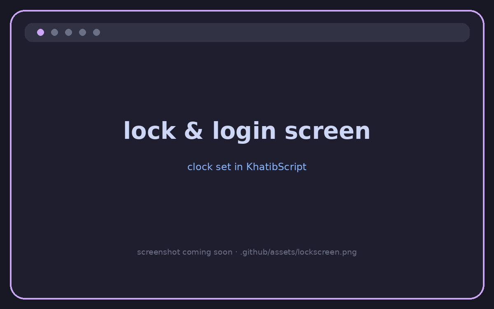

<div align="center">

# Anubis · Arch + Hyprland dotfiles

**A minimal, wallpaper-themed Hyprland desktop that I fully understand and can rebuild from this repo.**

Arch Linux · Hyprland 0.57 (Lua config) · uwsm · chezmoi · matugen · Catppuccin Mocha

</div>

<!-- SCREENSHOT: main desktop. Save as .github/assets/desktop.png, then replace this block with:
<p align="center"></p>
-->
> 📸 **Screenshot placeholder: desktop** (`.github/assets/desktop.png`): bar, terminal with fastfetch, a couple of windows.

---

## Contents
- [Why this exists](#why-this-exists)
- [Key features](#key-features)
- [Gallery](#gallery)
- [The stack](#the-stack)
- [Repository layout](#repository-layout)
- [Installation](#installation)
- [Daily use: keybindings](#daily-use-keybindings)
- [Design principles](#design-principles)
- [Strengths](#strengths)
- [Weaknesses and known issues](#weaknesses-and-known-issues)
- [Roadmap](#roadmap)
- [Credits](#credits)

## Why this exists

I started from [HyDE](https://github.com/HyDE-Project/HyDE), liked the look, and disliked
not knowing what half of it did. This repo rebuilds that look from scratch on a fresh Arch
install, one layer at a time, and keeps only what earns its place. HyDE stayed a
**visual reference**; none of its scripts, installer or theme engine are used.

The target machine is an **MSI Creator Z16** (i9-13980HX, Intel iGPU + RTX 4070 Max-Q,
2560×1600 panel at 1.67× scale) with a **Samsung Odyssey G5** (2560×1440 @ 165 Hz) wired to
the NVIDIA GPU. Most of it is portable; the hardware-specific parts are isolated and named
below.

## Key features

### 🎨 One wallpaper, one palette, everywhere
- Pick a wallpaper (`SUPER+Shift+W`) and **matugen** derives the accent colours from it.
  Bar, launcher, notifications, terminal, window borders, lock screen and GTK apps all recolour.
  No daemon or file watcher: one script, `wall-set`.
- **Catppuccin Mocha neutrals stay fixed** (base, mantle, surface, text), so text is always
  readable whatever the wallpaper. Only the accent roles follow the image.
- Wallpapers are grouped into theme folders (`~/Pictures/Wallpapers/<theme>/`) and browsed
  in a rofi grid with cached thumbnails.

### 🪟 A desktop that feels finished
- **Waybar** in modules (one file per group): workspaces, media island, weather, updates
  (cached and locked, so two monitors don't race), night light, notifications bell,
  battery, keyboard layout, and a native calendar tooltip.
- **Rofi** for everything: launcher, window switcher, files, emoji, clipboard history,
  animation presets, a live **keybinding cheat sheet** built from `hyprctl binds`, and a
  wlogout-style **tile power menu** with no extra package.
- **Hyprlock** as both lock screen and login screen: tty1 autologin starts the session
  behind it. Big clock in my own font, date, greeting, weather card, battery and layout.
- **Fades:** logout, reboot and shutdown dim both monitors to black first (`session-fade`
  over hyprsunset gamma).
- **Screenshots** (`shot`): region, frozen region, monitor, all. Always copied to the
  clipboard, optionally annotated in satty.
- Themed boot: **GRUB** with Catppuccin Mocha and a readable font size, a 2-second menu.

### 🤖 AI on the system, engine-agnostic
- `SUPER+Shift+Return` opens a floating AI agent terminal (Claude Code today).
- **Crash → notification → diagnosis.** When one of my programs crashes, a notification
  offers *Diagnose*. A click builds a facts report (package, earlier crashes, backtrace,
  journal window) and opens the agent on it in **read-only plan mode**. The core file
  itself never leaves the machine.
- `diag boot`, `diag unit NAME`, and `ask` (`journalctl -b -p err | ask "which matter?"`).
- **No vendor lock-in:** `~/.local/bin/ai` is the only file that names an engine. The
  engine is one line in `~/.config/ai/agent`. Instructions (`AGENTS.md`) and skills live
  in `~/.config/agents` and are linked into each engine's folder.

### 🔋 Laptop-aware
- Idle power on battery cut from **36.8 W to 17.5 W** (measured): the NVIDIA GPU is removed
  from the PCI bus on battery boots, TLP profile tuned, the panel runs at 60 Hz, and an
  always-redrawing border animation was found and stopped.
- Hybrid-GPU plumbing with **stable device names** (`/dev/dri/intel-igpu`,
  `/dev/dri/nvidia-dgpu`), because card numbers swap between boots.
- **Game mode** toggle strips the compositor down (no animations, blur or gaps) for games.

### 🛟 Safe to experiment
- Btrfs with flat subvolumes, **Timeshift** snapshots bootable from GRUB (grub-btrfs).
- `/etc` versioned with **etckeeper**; dotfiles in **chezmoi** with a reviewed diff before
  every apply.
- Every change in this repo came with a verification command, and a recovery step when
  it could break the session.

## Gallery

<!-- Replace each placeholder row with the image once captured, e.g.

-->
| | |
|:---:|:---:|
| 📸 **Lock / login screen**<br>`.github/assets/lockscreen.png` | 🎞️ **Wallpaper → palette (GIF)**<br>`.github/assets/theming.gif` |
| 📸 **Menus: launcher, power tiles, wallpapers**<br>`.github/assets/menus.png` | 🎞️ **Crash → Diagnose (GIF)**<br>`.github/assets/crash-diagnose.gif` |

## The stack

| Role | Choice | Why this one |
|---|---|---|
| Compositor | Hyprland, **Lua config** (`hl.*` API) | Real language: modules, functions, `pcall` fallbacks |
| Session | uwsm from tty1 | systemd-managed session without a display manager |
| Login / lock | hyprlock + hypridle | One look for both; autologin hands off to it |
| Bar | waybar | CSS styling, mature modules |
| Menus | rofi (Wayland) | One tool for every picker |
| Notifications | mako | Small, CSS-like config, reloadable |
| Wallpaper | awww | Animated transitions, no daemon fiddling |
| Theming | matugen + Catppuccin Mocha | Accents from the image, neutrals fixed |
| Night light / fades | hyprsunset | Native IPC, also used for fade-outs |
| Terminal / shell | kitty, zsh (modular `conf.d`), starship, fastfetch | |
| Files / browser | Thunar, Firefox | |
| Dotfiles / system | chezmoi, etckeeper, Timeshift | Reproducible home, versioned `/etc`, snapshots |
| AI | Claude Code (behind the `ai` dispatcher) | Swappable engine |

About 90 packages on top of the base install, **5 from the AUR**, each justified in
[`pkg_minimal.lst`](pkg_minimal.lst).

## Repository layout

```
.
├── README.md                  # this file (not deployed)
├── RUNBOOK.md                 # manual system steps: GRUB, autologin, watchdogs, AI CLI, apps
├── pkg_minimal.lst            # every package, one line each with the reason
├── first-launch.sh            # hybrid GPU: udev names + session env (run once)
├── run_onchange_after_*.sh    # chezmoi hooks: enable user units, GTK settings, folder emblem
├── dot_local/bin/             # ~/.local/bin: wall-set, shot, ai, diag, powermenu, bar-* ...
├── private_dot_config/
│   ├── hypr/                  # hyprland.lua + modules/ (monitors, input, look, animations,
│   │                          #   rules, binds, apps, autostart, gamemode), hyprlock, hypridle
│   ├── waybar/                # config.jsonc + modules/*.jsonc + CSS
│   ├── rofi/  mako/  kitty/  fastfetch/  starship.toml  gtk-3.0/  gtk-4.0/
│   ├── matugen/               # config.toml + templates/ (the only colour sources)
│   ├── zsh/                   # .zshrc + conf.d/NN-*.zsh (ZDOTDIR)
│   ├── uwsm/                  # session environment
│   ├── systemd/user/          # crash-notify.path/.service
│   ├── agents/                # AGENTS.md + skills/ (engine-neutral AI instructions)
│   ├── ai/  diag/             # AI engine choice, crash mute list
│   └── private_claude/        # links into Claude Code's config dir + seeded settings
└── private_dot_ssh/config     # agent settings only; keys are never tracked
```

Generated files (matugen outputs, AI engine state, SSH keys, runtime state) are listed in
[`.chezmoiignore`](.chezmoiignore) and never committed.

## Installation

> ⚠️ Built for one machine. Read [Weaknesses](#weaknesses-and-known-issues) first, and
> expect to adapt `monitors.lua` and the GPU setup to yours. The full rebuild has not yet
> been rehearsed in a VM (see [Roadmap](#roadmap)).

### 0. Prerequisites
A working Arch install with: Btrfs (flat subvolumes `@`, `@home`, `@log`, `@cache`, …),
GRUB, a normal user in `wheel`, and the base set from `pacstrap`
(listed at the top of [`pkg_minimal.lst`](pkg_minimal.lst)).

### 1. Bootstrap paru and fetch the repo
```bash
sudo pacman -S --needed git base-devel chezmoi
git clone https://aur.archlinux.org/paru-bin.git /tmp/paru-bin && (cd /tmp/paru-bin && makepkg -si)
chezmoi init https://github.com/Ahmedd3ly/dotfiles.git      # clone only, nothing applied yet
```

### 2. Install the packages
```bash
awk '!/^[[:space:]]*#/ && NF {print $1}' ~/.local/share/chezmoi/pkg_minimal.lst | paru -S --needed -
```
Read the inline comments: a few packages need a follow-up (`tlp`, `tlp-pd`, …).

### 3. Hybrid GPU (Intel + NVIDIA laptops only)
```bash
~/.local/share/chezmoi/first-launch.sh --primary intel     # --help explains the options
```
Run it **before** step 4: its lasting effect is the udev rule for stable GPU names. It
also writes the uwsm env files, which `chezmoi apply` then replaces with the tracked
versions (intentional; those are newer).

### 4. Review and apply the dotfiles
```bash
chezmoi diff | less      # see exactly what will be written
chezmoi apply
```
This also enables the user services (waybar, mako, hypridle, hyprsunset, ssh-agent,
crash notifications).

### 5. Wallpapers and first theme
Wallpapers are not in the repo. Put them in theme folders, then set one:
```bash
mkdir -p ~/Pictures/Wallpapers/catppuccin-mocha    # add 5-10 images
wall-set ~/Pictures/Wallpapers/catppuccin-mocha/<image>
```

### 6. Start the session
Log in on tty1: `~/.config/zsh/.zprofile` starts Hyprland through uwsm (after the
RUNBOOK autologin step, this happens on boot). Then check:
```bash
hyprctl reload && hyprctl configerrors     # expect no output
```

### 7. Manual system steps
[`RUNBOOK.md`](RUNBOOK.md) covers what chezmoi can't own (root files, firmware, accounts):
GRUB theme and font, tty1 autologin with hyprlock as the login screen, the watchdogs, the
AI agent CLI, Spotify/Spicetify and Vesktop theming, and the package audit. Take a Timeshift
snapshot after each.

## Daily use: keybindings

`SUPER+`` ` `` shows all of them, searchable, built live from Hyprland.

| Keys | Action | Keys | Action |
|---|---|---|---|
| `SUPER+Return` | Terminal | `SUPER+A` | App launcher |
| `SUPER+Shift+Return` | AI agent | `SUPER+Tab` | Window switcher |
| `SUPER+E` / `B` / `C` | Files / browser / editor | `SUPER+V` | Clipboard history |
| `SUPER+Q` | Close window | `SUPER+.` | Emoji |
| `SUPER+T` / `F` | Float / fullscreen | `SUPER+Shift+W` | Wallpaper + recolour |
| `SUPER+1…0` | Workspaces | `SUPER+Shift+Y` | Animation presets |
| `SUPER+Shift+S` | Screenshot region | `SUPER+Shift+C` | Colour picker |
| `SUPER+P` / `Print` | Monitor / all screens | `SUPER+Space` | Keyboard layout |
| `SUPER+L` | Lock | `Ctrl+Alt+Del` | Power menu |
| `SUPER+End` | Log out (fade) | `SUPER+Shift+R` | Reload Hyprland |

## Design principles

1. **Understand every line.** Each file starts with a banner and a `Why:` line.
2. **One concern per file.** `hyprland.lua` only requires modules; zsh loads numbered `conf.d` files.
3. **XDG-clean home.** Config in `~/.config`, data in `~/.local/share`, cache in `~/.cache`.
4. **Generated files are outputs.** Colours come only from `matugen/templates`; outputs are
   ignored and never hand-edited.
5. **Official repos first.** Every AUR package is justified in one line.
6. **Pure look vs plumbing.** Blur, rounding, animations and CSS are cheap. Theme
   switching and reload hooks cost complexity, so there is exactly one path for each.
7. **No resident extras.** No theme daemon, no file watchers, no AI background service.
   The crash watcher is a systemd path unit: zero processes while idle.

## Strengths

- **Reproducible and reviewable.** The home folder, the package list and the manual steps
  are all in one repo, and `chezmoi diff` shows every change before it lands.
- **Small, legible surface.** About 20 short scripts, no frameworks, no installer; each
  piece can be read in a minute and removed without breaking the rest.
- **Cohesive look at low cost.** The wallpaper drives the accents everywhere, while the fixed
  Mocha neutrals guarantee contrast.
- **Measured, not guessed.** Power savings, boot time and slow paths were profiled before
  being changed (e.g. a 4 s wallpaper step turned out to be PNG optimisation, not matugen).
- **Recoverable.** Bootable snapshots, versioned `/etc`, and recovery steps documented
  next to every risky change.
- **AI without lock-in or risk.** One adapter file, read-only diagnosis, never runs with
  permissions skipped, no secrets or core files sent.

## Weaknesses and known issues

Honest list, most important first.

- **Tied to one laptop.** Monitor modes, scale, the hybrid-GPU setup, power tuning and the
  `gpu-off` service assume the Z16. Another machine needs `monitors.lua`, `first-launch.sh`
  and the RUNBOOK power steps adapted.
- **External monitor on NVIDIA: HDR off.** With HDR/colour management active, DP-4 failed
  atomic commits and turned pink. Both HDR flags are forced off as a workaround; the root
  cause isn't isolated.
- **Battery floor.** Package C-states stay at PC3 even with the dGPU removed (blocker not
  identified), NVIDIA runtime D3 isn't supported, and the battery is at 61 % health with no
  charge-threshold control (firmware unsupported by msi-ec).
- **Young config API.** Hyprland's Lua config is new; key names change between releases, so
  updates need `hyprctl configerrors` checked against the shipped stubs.
- **Fractional-scale text clipping** in the polkit dialog (hyprtoolkit at 1.67×). Upstream
  issue, not filed yet.
- **Not everything is pacman-managed.** Claude Code uses its own installer and self-updates;
  the GRUB theme files are copied by hand. Both are documented in the RUNBOOK.
  `wkhtmltopdf-bin` pulls in `openssl-1.1`, built from the AUR.
- **Claude Code still creates an empty `~/.claude/`** despite `CLAUDE_CONFIG_DIR` (upstream bug).
- **Wallpapers live outside the repo**, so a rebuild needs them copied separately.
- **Snapshots are on the same disk.** Timeshift protects against bad changes, not disk
  failure; there is no off-machine backup yet.
- **Rebuild not rehearsed.** The install steps above are reconstructed from the history,
  not yet tested end to end.

## Roadmap

- [ ] **VM rebuild test** from a bare Arch install, then fix whatever the README got wrong.
- [ ] **Bootstrap script** wrapping installation steps 1–4, with a dry-run mode; trim
      `first-launch.sh` to the udev rule (the env files it writes are now tracked).
- [ ] **Off-machine backup** (e.g. restic or btrbk to an external disk), documented in the RUNBOOK.
- [ ] **CI on push:** shellcheck for scripts, stylua/luacheck for Hyprland modules, JSON lint for waybar.
- [ ] **Per-machine split** with chezmoi templates (`.chezmoi.hostname`) so a second machine reuses the look.
- [ ] **Wallpaper set in the repo** (Git LFS) or a fetch script with checksums.
- [ ] **AI:** a second engine adapter (verified flags), a scratchpad toggle on a special workspace,
      and diagnosis of root-owned service crashes.
- [ ] **File the upstream issues:** hyprtoolkit fractional-scale clipping, DP-4 HDR on NVIDIA.
- [ ] **Screenshots and GIFs** in this README (placeholders above).

## Credits

- [HyDE](https://github.com/HyDE-Project/HyDE): the look this rebuilds, used as a reference only.
- [Catppuccin](https://catppuccin.com): Mocha palette, GRUB theme, app themes.
- [matugen](https://github.com/InioX/matugen): Material You colours from the wallpaper.
- [Omarchy](https://github.com/basecamp/omarchy): the idea of crash → AI diagnosis, reimplemented engine-agnostically.
- Hyprland, waybar, rofi, mako, awww, kitty, chezmoi and every upstream project in the package list.

<sub>Personal configuration, shared as-is. Use whatever helps; check each piece against your own hardware.</sub>
